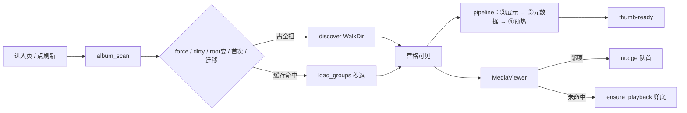

# 本地相册 — 加载与扫描流程

> **职责：** 扫描本地根 → 秒出宫格 → 后台展示资产（缩略图/HEIC 预览/尺寸）→ 元数据补空 → 按类型处理播放代理。  
> **页面：** `index.vue` · `MediaViewer.vue` · `LivePhotoPlayer.vue`  
> **实现：** `src-tauri/src/album/`（mod / scanner / thumbnail / db / media_meta / watcher / ffmpeg …）  
> **前置：** 设置页已配 `rootDir`；HEIC/视频建议捆绑 `ffmpeg` + `ffprobe`  
> **对齐：** 2026-10-16

姊妹文档：[云同步](./cloudSyncFlow.md) · [登录](./loginFlow.md) · [表目录](./schemaCatalog.md)


---

## 落地方案（目标架构 · 单一事实源）

### 四条管线

```text
① 索引 discover     路径 / size / mtime / Live 配对           → 秒出列表（阻塞 invoke）
   └─ sync 异物     output_dir 下非 `{yyyyMMdd}_{HHmmss}_{id16}`（及旧式 unix / `{unix}_{acct8}_{id16}`）媒体 → 移入 `pending/`（随后仍 discover，扁平宫格可见）
② 展示 thumb        网格图 + HEIC preview + 尺寸真源         → 不挡首屏
③ 元数据 meta       仅补 capture_at、camera（空才写；EXIF→文件名前缀） → 紧挨②成功之后
④ 播放 playback     H.264 代理或「源即可播」结论         → 扫描期后台预热，打开只读缓存
```

双模式：`gallery` 按日宫格 + 图库筛 + 年份轴；`files` 面包屑 + 当前层文件夹/媒体（`AlbumFileBrowser`）。discover 仍全库扁平；**排序/筛选只在前端**（`capture_at` 升序；无拍摄时间沉底；**不用** `modified`）；Rust 不排拍摄序。图库键 `origin`+`origin_account`。批量：更多菜单进意图 → 勾选/框选 → 执行（`useAlbumModeSelect`）。改拍摄时间可覆盖已有值（`source=user`，同步风格文件名前缀；EXIF 勾选才写）。

| 对象 | ④ 时机 | 说明 |
|------|--------|------|
| **HEVC / MOV** | **预热**：②③ 之后同 pipeline 转 `_play.mp4` | 实况与普通 HEVC 都走；打开命中缓存 |
| **H.264 且非 MOV** | **预热时写结论**：`playback_path` = 源路径 | 不转码、之后不再 ffprobe |
| 已有有效 `playback_path` | 跳过 | 非空文件才算命中 |
| 缓存未命中 | **兜底**：`album_ensure_playback` | 打日志；不作为主路径 |

Viewer / LivePhotoPlayer：**优先**已有 `playbackPath`。查看器把前后各 2 张插到预热队首（`album_nudge_playback`）。未命中才转码，视频先出缩略图，不挡住切换。

### 类型矩阵

| 类型 | ② 展示 | ③ 元数据 | ④ 播放 | 宫格画面 |
|------|--------|----------|--------|----------|
| JPG/PNG 等 | ≤8MP 进程内解码再缩 WebP；&gt;8MP 边解边缩。原图当缩略图仅 ≤100KB 且 ≤2MP | origin→EXIF→文件名；EXIF 机型 | — | thumb；大图禁止回退原路径 |
| HEIC/HEIF | ffmpeg **直接写**全尺寸 `_full.jpg`，再从该 JPEG 边解边缩 WebP。失败才 WIC 一次出两份 | 同上（EXIF 常弱，时间靠 origin/文件名） | — | thumb；预览必须 preview |
| **单独视频** | **只抽 1 帧**封面（管道，`-ss 0`） | 通常无 EXIF | HEVC 扫描期预热；H.264 非 MOV 记源路径 | 封面 WebP |
| **Live** | still 同上；**mov 不抽宫格帧** | still 的时间/机型 | **扫描期预热** mov | **still** thumb |

### 尺寸真源（禁止混用）

| 类型 | 时机 | 来源 | 禁止 |
|------|------|------|------|
| 栅格 ≤8MP | ② 解码成功 | 解码图宽高 | EXIF 覆盖；缩略图像素冒充原图 |
| 栅格 &gt;8MP | ② 边解边缩出缩略图 | **文件头**宽高 | 把缩略图边长写入 `width`/`height` |
| HEIC | ② 预览 JPEG 落盘后 | 预览 JPEG 的 `image_dimensions`（与源同分辨率） | 用 316 缩略图尺寸；为缩略图再持有全尺寸位图 |
| 单独视频 | 时长回填或打开兜底 | **`ffprobe` stream 宽高** | 海报帧当正式分辨率 |
| 非视频兜底 | ② 末轻量探测 | 文件头；HEIC 读不到则预览 JPEG | 不覆盖已有值 |

说明：抽首帧 ≠ 整段解码。宫格 WebP 边长约 316。8MP 只决定普通栅格缩略图是否整图进内存，不裁 HEIC 预览，也不裁查看器里的 JPEG 原图。

### 信息面板

`拍摄时间 · 机型 · 宽×高 · 目录 · 大小 · 序号`（缺项省略）。

| 字段 | 真源 |
|------|------|
| `capture_at` | 本表已有 → EXIF → 同步文件名前缀；下载时可将云端时间一次写入本表（`origin`） |
| `camera` | EXIF Make+Model（仅补空） |
| `width`/`height` | 尺寸真源表；③ **不写尺寸** |

### 目标 pipeline

```text
收集：缺 thumb / HEIC 缺 preview / Live 或视频缺播放结论
  → 并行②：小图池与 HEIC 池分开（HEIC 常态 ≤2，内存吃紧 ≤1）
  → 成功：写路径 + 尺寸 + emit（成品先 partial 再改名）
  → ③：仅补 capture_at、camera；非视频缺尺寸则文件头 / 预览 JPEG
  → ④：实况 MOV + 缺结论的普通视频；HEVC/MOV 转代理，H.264 非 MOV 写源路径
  → 末尾回填：缺 meta / 缺播放结论
打开：缓存命中直接播；未命中 ensure_playback 兜底（打日志）
查看器：前后各 2 张 album_nudge_playback 插到队首
```

### 不做

- 把 H.264 非 MOV 再转一遍  
- 用 8MP 去缩小 1200 万～2400 万的 HEIC 预览  
- 打开才生成 preview / 播放代理作为主路径  
- Live 宫格用 mov 首帧  
- discover 跑 EXIF / 转码  
- 海报尺寸覆盖 ffprobe  
- 按内容哈希共用缓存（删除一条路径会拆掉别人的文件）  

### 实现切片

| # | 项 | 状态 |
|---|----|------|
| A | 本文方案落盘 | ✅ |
| B | 视频分辨率走 ffprobe（时长回填或打开兜底），不写海报尺寸；EXIF 只补时间+机型 | ✅ |
| C | Live mov 与 HEVC 扫描预热；H.264 非 MOV 记源路径；Viewer 优先 playbackPath | ✅ |
| E | 性能：转码全局 ≤2 且单飞；HEIC 与小图分池；边解边缩；管道出帧；原子写；孤儿缓存清理 | ✅ |


---

## 一眼看懂



| 步 | 发生什么 | 用户看到 |
|----|----------|----------|
| 1 | **decide_path**：force / dirty / root 变 / 首次 / 迁移 → discover；否则 load_groups | — |
| 2a | **discover**：WalkDir → 复用缓存 → Live 配对 → upsert；开始前清零 dirty | 全页 loading |
| 2b | **load_groups** 秒返；不打断在跑 pipeline | 几乎无感 |
| 3 | 返回列表 + watcher（2s debounce→dirty） | **宫格出现** |
| 4 | pipeline：全扫必起；cache_hit 仅旧任务结束时补跑 | 进度条；占位→实图 |
| 5 | ②路径+尺寸 → ③时间/机型 → ④代理或可播结论 + emit | 卡片/信息条更新 |
| 5b | 末尾回填缺 meta / 缺播放结论 | 旧库补全 |
| 6 | Viewer 读缓存；未命中才兜底转码，先出缩略图 | 全屏预览 |
| 6b | 工具栏可打开相册根目录 | 系统文件夹 |

**硬规则（改代码勿破）：**

1. 两阶段：discover 阻塞返回；②③④绝不挡首屏。  
2. IPC **不传 base64**，只传路径 + `convertFileSrc`。  
3. 增量：`path + size + modified`；`fail_count ≥ 2` 跳过。  
4. 新扫描换 **cancel + epoch**；过期 pipeline 禁止写库 / emit。  
5. 取消 ≠ 失败；仅真实失败才 `fail_count++`。  
6. **dirty 在 cancel/wait 前清零**；discover 失败回滚 dirty。  
7. **cache_hit 不 cancel** 进行中的 pipeline。  
8. rootDir 变 → dirty + 清空 last_root → 下次必 discover。  
9. **HEVC/MOV 扫描期预热；H.264 非 MOV 只记可播结论**。打开转码只是未命中兜底。


---

## 速查

### UI 阶段

| 阶段 | `phase` | 全页 loading | 宫格 |
|------|---------|--------------|------|
| 未配根目录 | — | 空态 | 无 |
| discover | `discover` | 是 | 否 |
| load_groups 秒返 | `discover` | 几乎无感 | 是 |
| 缩略图/预热中 | `thumbnails`（可再分 live-proxy） | 否 | **是** |
| 完成 | — | 否 | 是 |

### 事件 / 命令

| 事件 | 前端 |
|------|------|
| `album://scan-progress` | 进度条文案 |
| `album://thumb-ready` | `pathIndex` O(1) 写回 thumb/preview/meta/playback |

| 命令 | 作用 |
|------|------|
| `album_scan(root, force?)` | dirty/force → discover 或 load_groups；按需起 pipeline（出图尺寸用编译期常量） |
| 同步入库 `enqueue_thumbs_from_sync` | iCloud/QQ 落盘后**仅静默** upsert `media.db`（origin/时间）；**不**入 pending、**不**启出图；用户点刷新 `album_scan` 再挂列表并出图 |
| `album_cancel_scan` | 取消 pipeline（离页）；force 全扫由内部 cancel |
| `album_get/save_settings` | `rootDir`；改 root 会强制下次全扫 |
| `album_ensure_playback` | 播放缓存未命中时的兜底；命中则不再 ffprobe。需要转码时顺带把分辨率落库 |
| `album_nudge_playback` | 查看器邻项插到预热队首；预热进行中由扫描循环消化 |
| `album_delete_local` | 原媒体回收站；缓存永久删；清 media.db；不碰 sync |
| `album_find_local_duplicates` | media.origin* 正本 vs 其它副本 |

### 缓存路径

```text
thumbs/v{ALBUM_CACHE_VERSION}/{hash}.webp       # 网格（先写 *.partial 再改名）
thumbs/v{ALBUM_CACHE_VERSION}/{hash}_full.jpg  # 仅 HEIC 全尺寸预览
thumbs/v{ALBUM_CACHE_VERSION}/{hash}_play.mp4  # HEVC/MOV 代理
hash ← stem + modified + size（目录代际在 v{N}）
```

`playback_path` 指向 `_play.mp4`，或等于源路径（已确认可直接播放）。0 字节文件不算命中。扫描开始会清掉空文件和数据库不再引用的成品，不删正在写的 `.partial`。

### 刷新 / dirty

| 入口 | force | 路径 |
|------|-------|------|
| mount 且 dirty/首次/root 变 | false | discover（含清孤儿缓存） |
| mount 且干净 | false | load_groups |
| 刷新 / 重试 | **true** | discover |
| watcher 2s | — | 只置 dirty，等下次刷新 |
| 设置改 rootDir | — | dirty + 清空 last_root |

---

## 细节（按需）

### discover

1. 开 `media.db`，`load_indexed_paths`；跳过 `SKIP_DIRS`。  
2. 扩展名 ∈ IMAGE ∪ VIDEO。  
3. 索引命中且缓存在 → 带 thumb/preview/playback/meta。  
4. 小图 &lt;100KB 非 HEIC/视频：thumb 复用原图。  
5. 每目录 `pair_live_photos` → 分组 → 事务 upsert；**陈旧 path 删行后 purge** 对应 thumb/preview/playback（外部删图重载也会清孤儿缓存）。

### pipeline（目标）

1. 跳过 `fail_count ≥ 2`。  
2. 收集缺 thumb / HEIC 缺 preview；**无缺口且 meta/尺寸/播放结论均齐 → 整段早退**。  
3. 并行②：小图与 HEIC 分池。HEIC 常态最多 2 路（可用内存 &lt; 2GB 时 1 路）；两边同时跑时小图池最多 2。视频抽帧**不写**海报尺寸。栅格超过约 8MP 边解边缩，不超过则进程内解码。  
4. ③ 限并发（约 4）仅补时间/机型；图尺寸走文件头，HEIC 用预览 JPEG。  
5. ④ 预热实况 MOV 与缺结论的普通视频。全局转码槽常态 2、内存吃紧 1；同一输出单飞；单进程 `-threads 2`。最长边 &gt; 3840 才收到 3840，CRF 23 / `veryfast` 不变。H.264 非 MOV 把源路径写入 `playback_path`。转码失败同样 `fail_count++`。  
6. 打开时缓存命中直接返回。未命中才 `ensure_playback`（日志 + 至多一次 ffprobe）。  
7. 写副作用前校验 `pipeline_epoch`。

### 清理重复下载

入口：工具栏 **清理重复** → `DuplicateCleanupModal` → `album_find_local_duplicates`。

| 概念 | 规则 |
|------|------|
| 范围 | 相册根**全量**媒体（含 sync 落盘目录） |
| 归组 | 主文件 **BLAKE3** 相同成组（先同 `size` 预筛再算哈希）；**不再**以文件名 stem 为主键 |
| 指纹缓存 | 写 `media.content_hash` + `hash_algo=blake3`；`size`/`modified` 变则清空；弹窗内懒算 |
| 正本 | **有 media.origin*** → **完整 Live（有 mov）** → 修改时间较新 |
| 一致程度 | **完全一致**（主文件及 Live mov 哈希同）/ **部分一致**（主画面同但 mov 缺或不一致） |
| Live | 同目录成对；归组看 still 哈希，再比 mov |
| 歧义 | 同组多个不同 `asset_id` → `ambiguousStem` |
| UI | 同组**横向滚动**；缩略图 IO root 用横滑容器（非仅纵滚），生成 **限流 2 路** |

删除所选 → `deleteAlbumLocal` → `album_scan(force:true)`。

### Live 配对（同目录）

完整 stem 相等，或 mov stem 去 `_hevc`/`_heic`/`_mov` 后与静帧 stem 相等 → `livephoto`，MOV 剔出列表。  
同步命名：`{yyyyMMdd}_{HHmmss}_{id16}.{ext}`（本地时区；账号隔离靠 `iCloudSync/<AppleID>/`、`QzoneSync/<uin>/`；旧 unix 名仍被扫描谓词接受，避免误收进 pending）。

### ffmpeg / ffprobe

| 项 | 说明 |
|----|------|
| 解析 | 捆绑 `resources/ffmpeg.exe` + `ffprobe.exe` → 资源目录 → PATH |
| 开发 | `pnpm run cs:ffmpeg-fetch` |
| HEIC | **不加 `-map`**；直接写最终 `_full.jpg`（不经临时 JPEG 再编码）；超时 60s；失败回退 WIC |
| 视频首帧 | `-ss 0` 在 `-i` 前，管道出 1 帧 JPEG（**不作**正式分辨率） |
| 视频分辨率 | 时长回填或打开兜底时 ffprobe `codec_name,width,height`；可播结论已入库则打开不再探测 |
| 播放代理 | HEVC/MOV → H.264 `_play.mp4`；扫描期预热。全局最多 2 路，同一文件单飞。最长边 &gt; 3840 才缩小 |

### Viewer

| kind | 画面 | 播放 |
|------|------|------|
| image | path；HEIC→previewPath | — |
| video | 转码未完成时先出 thumb | 优先 `playbackPath`；否则 `ensure_playback` |
| livephoto | still（HEIC→preview） | **优先 playbackPath**；否则兜底转码 |

键盘：`Esc` / `←` `→`；范围 = 当前扁平列表。

---

## 排查

| 现象 | 处理 |
|------|------|
| 宫格长期占位 | 看缩略图进度；查 ffmpeg |
| HEIC 空白 | 等 preview；或清缓存重扫 |
| HEIC 只有 512×512 | 清 `thumbs/v*` 重扫 |
| 视频分辨率不准 | 确认已走 ffprobe，非海报尺寸 |
| Live / HEVC 打开仍转圈 | 查 `playback_path` 是否已写入且文件非空；邻项 nudge 只加速，全库预热才是主路径 |
| 文件数不对 / 改文件不更新 | force 刷新 |
| db 与缓存不一致 | 同时删 `thumbs/` + `media.db` |

```powershell
Remove-Item -Recurse -Force "$env:APPDATA\com.ll.admin\album\thumbs"
Remove-Item -Force "$env:APPDATA\com.ll.admin\album\media.db" -ErrorAction SilentlyContinue
```

| 路径 | 内容 |
|------|------|
| `<appData>/album/settings.json` | rootDir |
| `<appData>/album/media.db` | 索引 + meta + fail_count |
| `<appData>/album/thumbs/v{N}/` | WebP + HEIC full + play 代理 |
| `{rootDir}/` | 用户相册根 |

调试：`pnpm run cs:dev` · `cargo test album::` · `cargo check`
